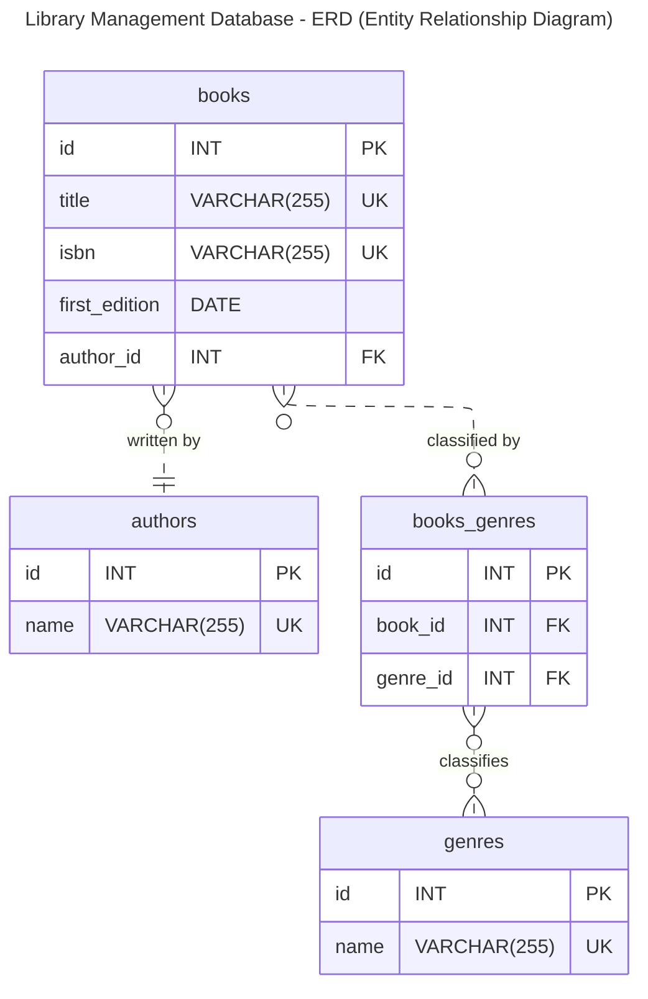
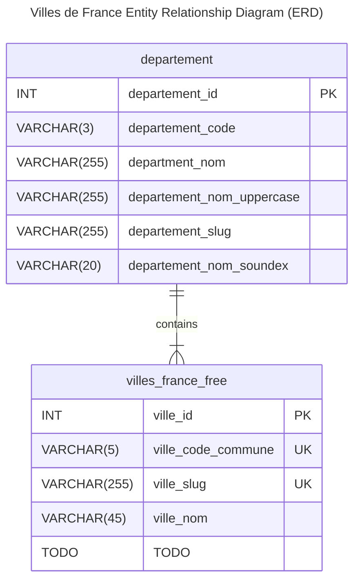

# sql-lab-library-schema

This project is composed of multiple labs (🇫🇷 exercices).


## Lab 1 - Database Schema Creation

### Presentation

In this SQL lab you will **create** a minimalist **database structure** for a **library management app**.  
The target **database** server is **MySQL**.  
The goal is to practice the SQL DDL statements (Data Defintiion Language) to create the database structure:

- Create the **database**,
- Create a **user** with total access to this database
- Create the **tables** and their **relationships** (**primary keys**, required (i.e., non null) fields, **foreign keys**)


### Terminology

<dl>
    <dt>DDL</dt>
    <dd>Data Definition Language</dd>
    <dt>FK</dt>
    <dd>Foreign Key is a field of a database table (B) whose values reference a row of another table (A) via its identifier (most often the primary key of table A)</dd>
    <dt>PK</dt>
    <dd>denotes the Primary Key, a field of a database table that must be present, not null, and indexed by default to improve search performance. Each value of the primary key column identifies unambiguously the row of the table it belongs to.</dd>
</dl>


### Lab 1 -  Statement

> Design a simplified data model for a library management application.
>
> - Your model should allow the following information:
>
>   - Book
>     - with the fields:
>       - `title` is a string (required), will be used as a search criterion 
>       - `isbn` is a string (required),  will be used as a search criterion
>       - `first_edition` the original release date (without time nor timezone)
>     - has relationships with other entities
>       - A book has exactly **one** author (contrieved for the sake of this exercise).
>       - A book is classified by zero or more genres.
> - Author
>     - has a `name` string (required) and used as a search criterion
>     - An author can write zero or more books
> - Genre
>     - has a `name` which is a string (required)
>     - A genre can classify zero or more books.
> - Define the entities
> - Define the associations between the tables using an identifier


#### ERD Diagram



> [!NOTE] 
> I created this **ERD (Entity Relationship Diagram)** with [Mermaid](https://mermaid.js.org/).  
> *Mermaid* is a Markdown extension that allows you to create various types of diagram
> with any text/Markdown editor.  
> There is no lock in to a costly application or online service.
> Mermaid is free and open-source.  
> And cherry on the cake, the diagram is a portion of text within a Markdown file, which brings interesting benefits.  
> You can add the diagram to your project code base and use version control to keep the diagram (documentation) in sync with the code.  
> Once rendered you get the visual diagram, some editors do it live.
> Many [tools (editor, IDE, platforms)](https://mermaid.js.org/ecosystem/integrations-community.html) **suppport** Mermaid, such as GitHub, GitLab, Wordpress, Slack, VsCode, Obsidian...

> [!TIP]
> You too can start creating your own ERD diagram today, simply read
> [the documentation](https://mermaid.js.org/syntax/entityRelationshipDiagram.html),
> and take a look at the [source code of this diagram](https://github.com/ebouchut-laplateforme/sql-lab-library-schema/blob/64dbd16d1e81a16e6f3027a6f907689a3b9dee11/README.md?plain=1#L53-L85) to get a concrete example.


#### Database Schema Creation Script

The schema creation SQL script [`config/database/schema.sql`](https://github.com/ebouchut-laplateforme/sql-lab-library-schema/blob/main/config/database/schema.sql) creates the database structure that is the database itself, a user with access to **this** database only, the tables, the keys, the junction table, and the refential integrity constraints).


## Lab 2 - Use SQL Queries to Answer Questions about French towns

The following section paraphrases issues #9 and #10 to make them visible even for someone with an archive of this repository but no access to these GitHub issues.

### Create the database, user, and tables

In this section we create a new database, a user which we grant full access to this database, and 2 tables.

This is part # 1 of the [Villes de France exercise](https://sql.sh/exercices-sql/villes-de-france).

- [x] Create a new database named `france` with the UTF8 character set:
    ```sql
    CREATE DATABASE france
        DEFAULT CHARACTER SET utf8mb4
    ;
    ```
- [x] Create a database user named `france` and give them all permissions on all database objects:  
    ```sql
    CREATE USER 'france'@'127.0.0.1'
        IDENTIFIED BY 'XXX'
    ;
    ```
- [x] Give all permissions to the `france` user on all objects of the `france`database:
    ```sql
    GRANT ALL PRIVILEGES ON france.*
        TO 'france'@'127.0.0.1'
    ;
    ```
- [x] Commit the original SQL import files:
    - [x] `config/database/imports/V2025-10-30135300-departement.sql`
    - [x] `config/database/imports/V2025-10-30135400-villes_france.sql`
- [x] Update these files to use `InnoDB` instead of `MyISAM` as the underlying engine, because we will need to use foreign keys. Commit the changes.
- [x] Run the SQL script to import the departments:  
    ```sql
    SOURCE /some/where/sql-lab-library-schema/config/database/imports/V2025-10-30135300-departement.sql;
    ```
- [x] Run the SQL script to import the cities:  
    ```sql
    SOURCE /some/where/sql-lab-library-schema/config/database/imports/V2025-10-30135300-villes_france.sql;
    ```

Once the `france` database is created and populated and we are connected to it with the `france` user; 
we will use SQL queries to answer questions about French towns and departments.


### Lab 2 Statement

You will find below my answers to the [villes de France exercise](https://sql.sh/exercices-sql/villes-de-france) on the useful [sql.sh](https://sql.sh/) website.
I explain below how to use SQL queries to answer the questions asked about French towns and departements.

First of, here is the schema of the `france` database.
The database contains 2 tables towns (`villes_france_free`) and departments (`departement`).

### Entity Relationship Diagram (ERD)



Except, there are no foreign keys, so the relationships do not exist as such in the above diagram. They are virtual.
Now, here is the detail of both tables.

### Table `villes_france_free`

```sql
SHOW CREATE TABLE villes_france_free \G
```

```txt
Table: villes_france_free
Create Table: CREATE TABLE 'villes_france_free' (
'ville_id' mediumint unsigned NOT NULL AUTO_INCREMENT,
'ville_departement' varchar (3) DEFAULT NULL,
'ville_slug' varchar(255) DEFAULT NULL,
'ville_nom' varchar (45) DEFAULT NULL,
'ville_nom_simple' varchar(45) DEFAULT NULL,
'ville_nom_reel' varchar (45) DEFAULT NULL,
'ville_nom_soundex' varchar(20) DEFAULT NULL,
'ville_nom_metaphone' varchar(22) DEFAULT NULL,
'ville_code_postal' varchar(255) DEFAULT NULL,
'ville_commune' varchar(3) DEFAULT NULL,
'ville_code_commune' varchar(5) NOT NULL,
'ville_arrondissement' smallint unsigned DEFAULT NULL,
'ville_canton' varchar(4) DEFAULT NULL,
'ville_amdi' smallint unsigned DEFAULT NULL,
'ville_population_2010' mediumint unsigned DEFAULT NULL,
ville_population_1999' mediumint unsigned DEFAULT NULL,
'ville_population_2012' mediumint unsigned DEFAULT NULL COMMENT 'approximatif',
'ville_densite_2010' int DEFAULT NULL,
'ville_surface' float DEFAULT NULL,
'ville_longitude_deg' float DEFAULT NULL,
'ville_latitude_deg' float DEFAULT NULL,
'ville_longitude_grd' varchar(9) DEFAULT NULL,
'ville_latitude_grd' varchar(8) DEFAULT NULL,
'ville_longitude_dms' varchar(9) DEFAULT NULL,
'ville_latitude_dms' varchar(8) DEFAULT NULL,
'ville_zmin' mediumint DEFAULT NULL,
'ville_zmax' mediumint DEFAULT NULL,
PRIMARY KEY (ville_id'),
UNIQUE KEY 'ville_code_commune_2' (ville_code_commune'),
UNIQUE KEY 'ville_slug' ('ville_slug'),
KEY 'ville_departement' (ville_departement'),
KEY 'ville_nom' (ville_nom'),
KEY 'ville_nom_reel' ('ville_nom_reel'),
KEY 'ville_code_commune' (ville_code_commune'),
KEY 'ville_code_postal' ('ville_code_postal'),
KEY 'ville_longitude_latitude_deg' ('ville_longitude_deg' ','ville_latitude_deg'),
KEY 'ville_nom_soundex' ('ville_nom_soundex'),
KEY 'ville_nom_metaphone' ('ville_nom_metaphone'),
KEY 'ville_population_2010' ('ville_population_2010'),
‹EY 'ville_nom_simple' ('ville_nom_simple )
) ENGINE=InnODB AUTO_INCREMENT=36831 DEFAULT CHARSET=utf8mb3
```

#### Table `departement`

```sql
SHOW CREATE TABLE departement \G
```

```txt
Create Table: CREATE TABLE `departement` (
  `departement_id` int NOT NULL AUTO_INCREMENT,
  `departement_code` varchar(3) CHARACTER SET utf8mb3 COLLATE utf8mb3_general_ci DEFAULT NULL,
  `departement_nom` varchar(255) CHARACTER SET utf8mb3 COLLATE utf8mb3_general_ci DEFAULT NULL,
  `departement_nom_uppercase` varchar(255) CHARACTER SET utf8mb3 COLLATE utf8mb3_general_ci DEFAULT NULL,
  `departement_slug` varchar(255) CHARACTER SET utf8mb3 COLLATE utf8mb3_general_ci DEFAULT NULL,
  `departement_nom_soundex` varchar(20) DEFAULT NULL,
  PRIMARY KEY (`departement_id`),
  KEY `departement_slug` (`departement_slug`),
  KEY `departement_code` (`departement_code`),
  KEY `departement_nom_soundex` (`departement_nom_soundex`)
) ENGINE=InnoDB AUTO_INCREMENT=102 DEFAULT CHARSET=latin1
```

### Lab 2 Answers

#### 1. List the 10 most populated towns in 2012

```sql
SELECT 
    ville_id,
    ville_slug,
    ville_nom,
    ville_population_2012
FROM 
    villes_france_free
ORDER BY ville_population_2012 DESC
LIMIT 10
;
```

ville_id | ville_slug | ville_nom | ville_code_commune | ville_population_2012 
---      | ---        | ---       | ---                | --
30438 | paris | PARIS | 75056 | 2211000
4440 | marseille | MARSEILLE | 13055 | 851400
28153 | lyon | LYON | 69123 | 474900
11719 | toulouse |TOULOUSE |31555 | 439600
2050 | nice | NICE | 06088 | 344900
16756 | nantes | NANTES | 44109 | 283300
27304 | strasbourg | STRASBOURG | 67482 | 272100
13339 | montpellier | MONTPELLIER | 34172 | 253000
12679 | bordeaux | BORDEAUX | 33063 | 235900
22745 | lille | LILLE | 59350 | 225800


#### 2. List of the 50 towns with the smallest surface area

```sql
SELECT 
	ville_id,
	ville_nom,
	ville_surface
FROM 
	villes_france_free
ORDER BY
	ville_surface
LIMIT 50
;
```

Result

| ville_id | ville_nom               | ville_surface |
|----------|------------------------ |-------------- |
|    12988 | CASTELMORON-D'ALBRET    |          0.04 |
|     7981 | PLESSIX-BALISSON        |          0.08 |
|    36178 | VAUDHERLAND             |          0.09 |
|    22779 | LANNOY                  |          0.18 |
|    33907 | MALLIEVRE               |           0.2 |
|    13107 | SAINT-ANTOINE           |           0.2 |
|    10276 | LA FERRIERE-SUR-RISLE   |          0.24 |
|    26695 | SAINTE-MARIE            |          0.28 |
|    29497 | BOURG-LE-ROI            |          0.36 |
|    27126 | MONT-LOUIS              |          0.39 |
|      528 | LE CATELET              |          0.41 |
|    28176 | RIVERIE                 |          0.42 |
|    21514 | LA ROCHE-BERNARD        |          0.43 |
|     7822 | CHATELAUDREN            |          0.46 |
|     7779 | MONCONTOUR              |          0.48 |
|    12965 | SAINTE-FOY-LA-GRANDE    |          0.51 |
|      208 | SAINT-LAURENT-SUR-SAONE |          0.53 |
|    26909 | SASSIS                  |          0.53 |
|    26526 | THUY                    |          0.53 |
|     8374 | MONPAZIER               |          0.53 |
|    13763 | BECHEREL                |          0.57 |
|    10070 | VIEUX-PORT              |          0.57 |
|     3635 | FAYS-LA-CHAPELLE        |          0.58 |
|     7467 | SAINT-JEAN-DE-LOSNE     |          0.58 |
|     1928 | MONT-DAUPHIN            |          0.58 |
|    11137 | ILE-DE-SEIN             |           0.6 |
|    18718 | BARFLEUR                |           0.6 |
|    19722 | SAINT-THIEBAULT         |          0.61 |
|    22068 | NEUFVILLAGE             |          0.61 |
|    24471 | LE MELE-SUR-SARTHE      |          0.62 |
|    27552 | SCHIRRHOFFEN            |          0.63 |
|    25125 | LA LOGE                 |          0.68 |
|    27583 | LA WALCK                |          0.68 |
|    35964 | LE PRE-SAINT-GERVAIS    |           0.7 |
|    20190 | COUPTRAIN               |          0.71 |
|    26689 | ARMENTEULE              |          0.71 |
|    21860 | SAINTE-RUFFINE          |          0.71 |
|    36058 | MARGENCY                |          0.72 |
|     3441 | LES NOES-PRES-TROYES    |          0.73 |
|    11069 | ILE-MOLENE              |          0.75 |
|    26601 | LUGAGNAN                |          0.75 |
|    15196 | CHENE-SEC               |          0.76 |
|    36096 | GOUZANGREZ              |          0.77 |
|    36392 | PIAZZALI                |          0.78 |
|    33813 | SAINT-PANTALEON         |          0.78 |
|     3197 | CHATEAU-VERDUN          |          0.79 |
|    26835 | ESTARVIELLE             |          0.82 |
|    11847 | TREBONS-DE-LUCHON       |          0.83 |
|    35663 | BOURG-SOUS-CHATELET     |          0.84 |
|    10908 | LOCQUENOLE              |          0.85 |


#### 3. List of overseas departments

List of **overseas departments**, i.e., those whose **department number** **starts with `97`**.

```sql
SELECT 
    departement_id,
    departement_code,
    departement_nom
FROM 
    departement
WHERE
    departement_code LIKE '97%'
;
```

Result:

| departement_id | departement_code | departement_nom |
|----------------|------------------|-----------------|
|             98 | 971              | Guadeloupe      |
|            100 | 972              | Martinique      |
|             99 | 973              | Guyane          |
|            101 | 974              | Réunion         |
|             97 | 976              | Mayotte         |


####  4. List the names of the 10 most populous towns in 2012, and the name of the associated department

```sql
SELECT
    v.ville_id,
    v.ville_nom,
    v.ville_departement,
    d.departement_nom,
    v.ville_population_2012
FROM villes_france_free v
    INNER JOIN departement d ON d.departement_code = v.ville_departement
ORDER BY
    ville_population_2012 DESC
LIMIT 10
;
```

Result:

| ville_id | ville_nom   | ville_departement | departement_nom   | ville_population_2012 |
|----------|-------------|-------------------|-------------------|-----------------------|
|    30438 | PARIS       | 75                | Paris             |               2211000 |
|     4440 | MARSEILLE   | 13                | Bouches-du-Rhône  |                851400 |
|    28153 | LYON        | 69                | Rhône             |                474900 |
|    11719 | TOULOUSE    | 31                | Haute-Garonne     |                439600 |
|     2050 | NICE        | 06                | Alpes-Maritimes   |                344900 |
|    16756 | NANTES      | 44                | Loire-Atlantique  |                283300 |
|    27304 | STRASBOURG  | 67                | Bas-Rhin          |                272100 |
|    13339 | MONTPELLIER | 34                | Hérault           |                253000 |
|    12679 | BORDEAUX    | 33                | Gironde           |                235900 |
|    22745 | LILLE       | 59                | Nord              |                225800 |


#### 5. List the name and code of departments, and the number of towns within that department, sorted with the departments with the most towns first

```sql
SELECT
    d.departement_nom,
    d.departement_code,
    d.departement_nom,
    COUNT(v.ville_id)   AS ville_count
FROM departement d
    INNER JOIN villes_france_free v ON v.ville_departement = d.departement_code
GROUP BY d.departement_nom
ORDER BY ville_count DESC
;
```

Result:


| departement_nom         | departement_code | departement_nom         | ville_count |
|------------------------|------------------|-------------------------|--------------|
| Pas-de-Calais           | 62               | Pas-de-Calais           |         895 |
| Aisne                   | 02               | Aisne                   |         816 |
| Somme                   | 80               | Somme                   |         782 |
| Seine-Maritime          | 76               | Seine-Maritime          |         745 |
| Moselle                 | 57               | Moselle                 |         730 |
| Calvados                | 14               | Calvados                |         706 |
| Côte-d'or               | 21               | Côte-d'or               |         706 |
| Oise                    | 60               | Oise                    |         693 |
| Eure                    | 27               | Eure                    |         675 |
| Nord                    | 59               | Nord                    |         650 |
| Marne                   | 51               | Marne                   |         620 |
| Manche                  | 50               | Manche                  |         601 |
| Doubs                   | 25               | Doubs                   |         594 |
| Meurthe-et-Moselle      | 54               | Meurthe-et-Moselle      |         594 |
| Haute-Garonne           | 31               | Haute-Garonne           |         589 |
| Saône-et-Loire          | 71               | Saône-et-Loire          |         573 |
| Dordogne                | 24               | Dordogne                |         557 |
| Pyrénées-Atlantiques    | 64               | Pyrénées-Atlantiques    |         547 |
| Haute-Saône             | 70               | Haute-Saône             |         545 |
| Jura                    | 39               | Jura                    |         544 |
| Gironde                 | 33               | Gironde                 |         542 |
| Isère                   | 38               | Isère                   |         533 |
| Bas-Rhin                | 67               | Bas-Rhin                |         527 |
| Vosges                  | 88               | Vosges                  |         515 |
| Seine-et-Marne          | 77               | Seine-et-Marne          |         514 |
| Orne                    | 61               | Orne                    |         505 |
| Meuse                   | 55               | Meuse                   |         500 |
| Hautes-Pyrénées         | 65               | Hautes-Pyrénées         |         474 |
| Charente-Maritime       | 17               | Charente-Maritime       |         472 |
| Puy-de-Dôme             | 63               | Puy-de-Dôme             |         470 |
| Ardennes                | 08               | Ardennes                |         463 |
| Gers                    | 32               | Gers                    |         463 |
| Yonne                   | 89               | Yonne                   |         455 |
| Aude                    | 11               | Aude                    |         438 |
| Aube                    | 10               | Aube                    |         433 |
| Haute-Marne             | 52               | Haute-Marne             |         433 |
| Ain                     | 01               | Ain                     |         419 |
| Charente                | 16               | Charente                |         404 |
| Eure-et-Loir            | 28               | Eure-et-Loir            |         403 |
| Haut-Rhin               | 68               | Haut-Rhin               |         377 |
| Sarthe                  | 72               | Sarthe                  |         375 |
| Côtes-d'armor           | 22               | Côtes-d'armor           |         373 |
| Drôme                   | 26               | Drôme                   |         369 |
| Maine-et-Loire          | 49               | Maine-et-Loire          |         363 |
| Gard                    | 30               | Gard                    |         353 |
| Ile-et-Vilaine          | 35               | Ile-et-Vilaine          |         353 |
| Hérault                 | 34               | Hérault                 |         343 |
| Lot                     | 46               | Lot                     |         340 |
| Ardèche                 | 07               | Ardèche                 |         339 |
| Loiret                  | 45               | Loiret                  |         334 |
| Ariège                  | 09               | Ariège                  |         332 |
| Landes                  | 40               | Landes                  |         331 |
| Loire                   | 42               | Loire                   |         327 |
| Tarn                    | 81               | Tarn                    |         323 |
| Allier                  | 03               | Allier                  |         320 |
| Lot-et-Garonne          | 47               | Lot-et-Garonne          |         319 |
| Nièvre                  | 58               | Nièvre                  |         312 |
| Savoie                  | 73               | Savoie                  |         305 |
| Deux-Sèvres             | 79               | Deux-Sèvres             |         305 |
| Aveyron                 | 12               | Aveyron                 |         304 |
| Haute-Savoie            | 74               | Haute-Savoie            |         294 |
| Rhône                   | 69               | Rhône                   |         293 |
| Loir-et-Cher            | 41               | Loir-et-Cher            |         291 |
| Cher                    | 18               | Cher                    |         290 |
| Corrèze                 | 19               | Corrèze                 |         286 |
| Finistère               | 29               | Finistère               |         283 |
| Vendée                  | 85               | Vendée                  |         282 |
| Vienne                  | 86               | Vienne                  |         281 |
| Indre-et-Loire          | 37               | Indre-et-Loire          |         277 |
| Yvelines                | 78               | Yvelines                |         262 |
| Mayenne                 | 53               | Mayenne                 |         261 |
| Morbihan                | 56               | Morbihan                |         261 |
| Cantal                  | 15               | Cantal                  |         260 |
| Creuse                  | 23               | Creuse                  |         260 |
| Haute-Loire             | 43               | Haute-Loire             |         260 |
| Indre                   | 36               | Indre                   |         247 |
| Haute-corse             | 2b               | Haute-corse             |         236 |
| Pyrénées-Orientales     | 66               | Pyrénées-Orientales     |         226 |
| Loire-Atlantique        | 44               | Loire-Atlantique        |         221 |
| Haute-Vienne            | 87               | Haute-Vienne            |         201 |
| Alpes-de-Haute-Provence | 04               | Alpes-de-Haute-Provence |         200 |
| Essonne                 | 91               | Essonne                 |         196 |
| Tarn-et-Garonne         | 82               | Tarn-et-Garonne         |         195 |
| Lozère                  | 48               | Lozère                  |         185 |
| Val-d'oise              | 95               | Val-d'oise              |         185 |
| Hautes-Alpes            | 05               | Hautes-Alpes            |         177 |
| Alpes-Maritimes         | 06               | Alpes-Maritimes         |         163 |
| Var                     | 83               | Var                     |         153 |
| Vaucluse                | 84               | Vaucluse                |         151 |
| Corse-du-sud            | 2a               | Corse-du-sud            |         124 |
| Bouches-du-Rhône        | 13               | Bouches-du-Rhône        |         119 |
| Territoire de Belfort   | 90               | Territoire de Belfort   |         102 |
| Val-de-Marne            | 94               | Val-de-Marne            |          47 |
| Seine-Saint-Denis       | 93               | Seine-Saint-Denis       |          40 |
| Hauts-de-Seine          | 92               | Hauts-de-Seine          |          36 |
| Guadeloupe              | 971              | Guadeloupe              |          34 |
| Martinique              | 972              | Martinique              |          34 |
| Réunion                 | 974              | Réunion                 |          24 |
| Guyane                  | 973              | Guyane                  |          22 |
| Mayotte                 | 976              | Mayotte                 |          17 |
| Paris                   | 75               | Paris                   |           1 |


#### 6. List of the 10 departments with the largest area

```sql
SELECT
	departement_id,
	departement_code,
	departement_nom,
	SUM(v.ville_surface) AS departement_surface
FROM villes_france_free  v
  INNER JOIN departement d ON d.departement_code = v.ville_departement
GROUP BY departement_code
ORDER BY departement_surface DESC
LIMIT 10
;
```

Result:

| departement_id | departement_code | departement_nom        | departement_surface |
|----------------|------------------|------------------------|---------------------|
|             99 | 973              | Guyane                 |               83531 |
|             34 | 33               | Gironde                |   9975.590021006763 |
|             41 | 40               | Landes                 |   9242.600034713745 |
|             25 | 24               | Dordogne               |   9060.009986400604 |
|             22 | 21               | Côte-d'or              |   8763.209993898869 |
|             12 | 12               | Aveyron                |    8735.12000989914 |
|             72 | 71               | Saône-et-Loire         |   8574.689991354942 |
|             52 | 51               | Marne                  |   8161.580004692078 |
|             64 | 63               | Puy-de-Dôme            |   7969.659985780716 |
|             65 | 64               | Pyrénées-Atlantiques   |   7644.760017037392 |


#### 7. Count the number of towns whose names begin with `Saint`

```sql
SELECT
    COUNT(*) AS nombre_de_villes_qui_commencent_par_Saint
FROM villes_france_free
WHERE
    ville_nom LIKE 'Saint%'
;
```

Result:

| nombre_de_villes_qui_commencent_par_Saint |
|-------------------------------------------|
|                                      4260 |


#### 8. List of towns with names that appear more than once, sorted so that those whose names are most commonly used by several towns appear first

```sql
SELECT
  ville_id,
  ville_nom,
  ville_surface
FROM  villes_france_free
WHERE ville_surface IS NOT NULL
    AND ville_surface > (
        SELECT 
	    AVG(ville_surface)
	FROM villes_france_free
    )
ORDER BY ville_surface DESC
;
```

Results (only the first 10):

| ville_id | ville_nom               | ville_surface |
|----------|-------------------------|---------------|
|    36650 | MARIPASOULA             |         18360 |
|    36635 | REGINA                  |         12130 |
|    36651 | CAMOPI                  |         10030 |
|    36640 | MANA                    |          6332 |
|    36653 | SAINT-ELIE              |          5680 |
|    36645 | SAINT-LAURENT-DU-MARONI |          4830 |
|    36649 | SAUL                    |          4475 |
|    36644 | ROURA                   |          3902 |
|    36637 | IRACOUBO                |          2762 |
|    36656 | POMPIDOU PAPA ICHTON    |          2628 |


#### 10. List the departments with more than 2 million inhabitants

```sql
SELECT
	d.departement_nom,
	SUM(v.ville_population_2012) AS population_departement_2012
FROM departement d
	LEFT JOIN villes_france_free v ON d.departement_code = v.ville_departement
GROUP BY d.departement_nom
HAVING   population_departement_2012 > 2000000
;
```

Results:

| departement_nom | population_departement_2012 |
|-----------------|-----------------------------|
| Nord            |                     2565600 |
| Paris           |                     2211000 |


#### 11. Replace the dashes with a space for all towns beginning with "SAINT-" (in the column containing names in capital letters).

TLDR;

```sql
UPDATE villes_france_free
    SET ville_nom = REPLACE(ville_nom, '-', ' ')
WHERE ville_nom LIKE 'SAINT-%'
;
```

Results (only the first 10):

| ville_nom                    |
|------------------------------|
| SAINT ABIT                   |
| SAINT ABRAHAM                |
| SAINT ACHEUL                 |
| SAINT ADJUTORY               |
| SAINT ADRIEN                 |
| SAINT AFFRIQUE               |
| SAINT AFFRIQUE LES MONTAGNES |
| SAINT AGATHON                |
| SAINT AGIL                   |
| SAINT AGNAN                  |


I also played to build a non-destructive, but more sledgehammer-like version.

This one helped me learn about temporary tables and their peculiarities when used within a transaction. 

A **temporary table created within a transaction persists after the transaction is rolled back!**.  
Once more, it is NOT dropped when the transaction is rolled back. This is why I dropped myself it after the rollback.

AFAIK, `CREATE TEMPORARY TABLE ...` is the only DDL statement in MySQL that is not transactional. A temporary table is only removed at the end of the **session**. 
[Source](https://dev.mysql.com/doc/refman/8.0/en/implicit-commit.html)

```sql
BEGIN;

CREATE TEMPORARY TABLE villes_saint (
	id  INT
);

INSERT INTO villes_saint (id)
    SELECT ville_id
    FROM villes_france_free
    WHERE ville_nom LIKE 'SAINT-%'
;

UPDATE villes_france_free
    SET ville_nom = REPLACE(ville_nom, '-', ' ')
WHERE ville_nom LIKE 'SAINT-%'
;

SELECT
    ville_nom
FROM villes_france_free
WHERE ville_id IN (SELECT id FROM villes_saint)
ORDER BY ville_nom
LIMIT 10
;

ROLLBACK;

DROP TEMPORARY TABLE villes_saint;
```
